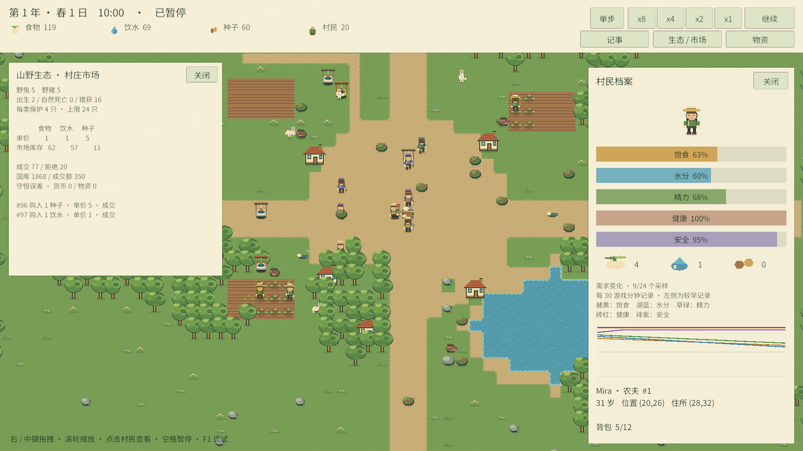
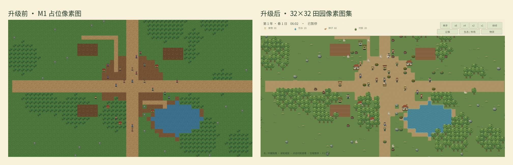

# My AI World

一款以**上帝视角、像素风、持续运行的模拟世界**为目标的原型工程。当前 **M4 存档与社会记忆首版**已实现：20 个 NPC 自主生存、种植、狩猎和交易，能问候邻居、赠送食物、记住受助经历，并按信任选择后续帮助对象。世界支持手动/每日自动存档、备份、版本迁移及精确恢复；中文人物档案与时间线可查看互助原因链。验证与边界见 [M4 记录](Docs/Progress/Milestone-04.md)。

最终愿景是让每个 NPC 都成为拥有身份、需求、记忆、关系和目标的“模拟人”，并在后期以 **规则 AI + 可选 LLM 高层决策** 的方式扩展。LLM 永远只提供结构化意图，不能直接修改世界状态；即使关闭 LLM，世界也必须正常运行。



> 上图为 **1920×1080** 验收画面：顶栏常驻摘要，生态/市场详情与 NPC 检查器同屏，需求曲线、背包图标和计划信息可见。

同视角美术前后对照（均为 1920×1080）：



## 当前状态

| 项目 | 状态 |
|---|---|
| 引擎 | Tuanjie 1.8.2（编辑器 2022.3.62t4，Unity 2022.3 API 兼容） |
| M1 / M2 / M3 核心切片 | 已实现，默认 20 NPC、四种子各通过 14 游戏日验证 |
| 32×32 美术与动画 | 首版完成：地图分层、地形变体、树/岩/建筑、五职业、兔/野猪逐帧动画 |
| 中文 HUD | 首版完成：顶栏摘要、三个详情面板、NPC 检查器、需求曲线、F1 调试 |
| 自动测试 | 默认独立代码测试：快速集 392 项，长周期回归 13 项；编辑器配置 1 项、PlayMode 64 项按需执行，见 [测试运行说明](Docs/Testing.md) |
| 存档 / 社会记忆 | 手动与每日自动存档、备份恢复、单向信任、问候/赠食、人物事件时间线 |
| 视觉验收 | 首版仅以 1920×1080 为验收目标；白天/黄昏/夜晚；动物逃跑与近景细节 |
| LLM | 未接入，M5 计划 |

## 运行方式

1. 用 Tuanjie Hub 打开本目录（`my-world`）。
2. 等待包导入和脚本编译完成。
3. 打开 `Assets/Game/Scenes/Bootstrap.unity`。
4. 点击 Play。

美术资源已随工程提交。如需重新生成图集，执行 **Tools → My AI World → Art → Generate Pastoral Art**；该操作只重写 `Assets/Game/Resources/Pastoral/` 下的 PNG 与配置，不会重建场景或重置世界配置。

> 如果 Build Settings 里没有 `Bootstrap`，或场景引用异常，运行菜单 **Tools → My AI World → Build Bootstrap Scene** 重新生成配置、场景和 Build Settings 条目。此操作会重置配置默认值，请谨慎使用。

## 操作

| 操作 | 功能 |
|---|---|
| WASD / 方向键 | 平移摄像机 |
| 鼠标右键或中键拖拽 | 平移摄像机 |
| 滚轮 | 整数倍像素缩放（1×–6×） |
| 左键点击 NPC | 选中并查看头像、需求、背包、钱包/产出、计划与历史曲线 |
| Esc | 取消选中并关闭检查器 |
| Space | 暂停 / 继续 |
| 1 / 2 / 3 / 4 | 1× / 2× / 4× / 8× 速度 |
| `.` | 暂停时单步一个游戏分钟 |
| 物资 / 生态·市场 / 记事 | 展开对应详情面板；同一时间只展开一个 |
| F1 | 显示 / 隐藏完整调试面板（含“生成村民”按钮） |
| F5 / F9 | 手动保存 / 读取；读取成功后暂停 |
| 保存 / 读取 / 自动档 | 保存手动档、读取手动档、读取最近的自动档 |
| 备份 / 自动备份 | 分别读取上一次成功的手动档 / 自动档 |
| 记事 → 当前村民 | 查看选中村民保留的互动经历、信任变化与回报原因 |

## 目录

```text
Assets/Game/
├─ Config/                    # WorldConfig.asset
├─ Resources/Pastoral/        # 生成的图集、PastoralArt.asset、中文字体与 OFL 许可
├─ Scenes/Bootstrap.unity     # 唯一启动场景
├─ Scripts/Sim/               # 纯 C# 确定性模拟，无 UnityEngine 依赖
├─ Scripts/App/               # Session、时间驱动、只读查询模型、日志、回放
├─ Scripts/Presentation/      # 相机、Tilemap、Sprite、选择、中文运行时 UI
├─ Editor/                    # 场景/配置、像素图集生成、验证与视觉审查工具
└─ Tests/                     # EditMode 与 PlayMode 测试
Docs/
├─ Architecture.md
├─ Roadmap.md
├─ Progress/Milestone-01.md
├─ Progress/Milestone-02.md
├─ Progress/Milestone-03.md
├─ Progress/Milestone-03-ArtUpgrade.md
├─ Progress/ArtUpgrade/       # 1920×1080 昼夜、逃跑与前后对照截图
└─ Preview/
Logs/TestResults/             # 自动测试结果（运行测试后生成）
```

## 架构要点

- **规则与表现解耦**：`MyAiWorld.Sim` 的 asmdef 设置了 `noEngineReferences: true`，模拟核心不使用 Unity API。
- **确定性**：1 tick = 1 游戏分钟；固定顺序、稳定 `EntityId` 排序、独立随机流、整数状态、状态哈希 v4（包括关系与记忆）。
- **表现只读**：选择、面板、动画和相机只消费 App 层不可变快照；视觉随机流与模拟随机流分离。
- **可观察**：结构化 JSONL 会话日志、回放摘要、中文 HUD、需求曲线和 F1 调试信息。
- **可替换美术**：所有切片由 `PastoralArt.asset` 的 key 引用；生成器与场景重建解耦。
- **目标分辨率**：首版只针对 1920×1080 做布局与像素对齐验收；UI 直接以 1920×1080 为目标并按 1.5× 像素缩放布局，相机默认 PPU 32、1× 像素缩放。

详细设计见 [Docs/Architecture.md](Docs/Architecture.md)，路线图见 [Docs/Roadmap.md](Docs/Roadmap.md)。

## 测试

日常从仓库根目录直接运行代码测试，无需启动或连接编辑器：

```bash
python3 tools/test.py                                  # 默认快速集
python3 tools/test.py --filter HuntingGameplayTests    # 仅相关测试
python3 tools/test.py --no-build                       # 只用有效缓存，禁止编译
python3 tools/test.py full                             # 按需包含长周期回归
```

首次使用已安装的 Tuanjie Mono 编译生产源码与 NUnit 测试，后续缓存未变化的程序集。结果为 `Logs/TestResults/Code-*.json` 和 `.xml`。需要已恢复工程的 NUnit 与 Newtonsoft 包；自定义安装路径使用 `--editor /path/to/Tuanjie.app`。

涉及场景、输入或渲染接线时，在编辑器内退出 Play Mode，执行 **Tools → My AI World → Verification → Run PlayMode Smoke Tests**（4 项）。完整 **Run EditMode Tests / Run PlayMode Tests** 保留用于按需验收，结果为 `Logs/TestResults/*-CurrentProject.json`。运行游戏时可用同菜单的 **Inspect First NPC** 暂停并查看首个 NPC。

命令行方式需先关闭此工程的编辑器；不要加 `-quit`，否则测试进程会提前退出：

```bash
TUANJIE="/Applications/Tuanjie/Hub/Editor/2022.3.62t4/Tuanjie.app/Contents/MacOS/Tuanjie"
PROJECT="/Users/slg/workspace/my-ai-game/my-world"
mkdir -p "$PROJECT/Logs/TestResults"

"$TUANJIE" -batchmode -nographics -projectPath "$PROJECT" \
  -runTests -testPlatform EditMode \
  -testResults "$PROJECT/Logs/TestResults/EditMode.xml" \
  -logFile "$PROJECT/Logs/TestResults/EditMode.log"

"$TUANJIE" -batchmode -projectPath "$PROJECT" \
  -runTests -testPlatform PlayMode \
  -testResults "$PROJECT/Logs/TestResults/PlayMode.xml" \
  -logFile "$PROJECT/Logs/TestResults/PlayMode.log"
```

快速集实测 392 项全部通过，首次构建加运行共 3.42 秒，复用缓存时共 1.79 秒；长周期回归及引擎测试按需执行。本轮将 7 项纯数据用例从 PlayMode 迁移至代码测试，没有删除断言。完整范围、缓存行为与验证记录见 [测试运行说明](Docs/Testing.md)。历史 M4 通过记录见 [M4 记录](Docs/Progress/Milestone-04.md)。

存档位于 `Application.persistentDataPath/MyAiWorld/saves/`：`manual.json`、`auto.json` 和各自的 `.bak`。每个游戏日午夜自动保存。文件损坏或不可写时保留当前世界，并在底部状态栏提示。M4.1 的 v1 存档会迁移至 v2；M1–M3 的日志/回放摘要不是完整存档。读取后世界暂停，需求曲线从恢复时刻重新采样。

PlayMode 测试成功后，可启动 Bootstrap，再用 **Tools → My AI World → Verification → Review M4 Reciprocal Help** 查看可复现的受助与回报场景。它读取测试产物，不覆盖玩家存档。

## 授权

- 代码与程序化像素图集为本工程内容。
- 中文界面字体为 **Noto Sans SC**，按 **SIL Open Font License 1.1** 随项目分发；许可全文见 `Assets/Game/Resources/Pastoral/Fonts/OFL.txt`。
- 其余引擎与包依赖遵循各自许可证。

## 后续范围

复杂社会关系（债务/恐惧/谣言）、长期记忆摘要、完整回放播放器、LLM、多地图、手绘 Aseprite 管线、天气和更多动物种类尚未实现。这些按 `Docs/Roadmap.md` 分阶段推进。
